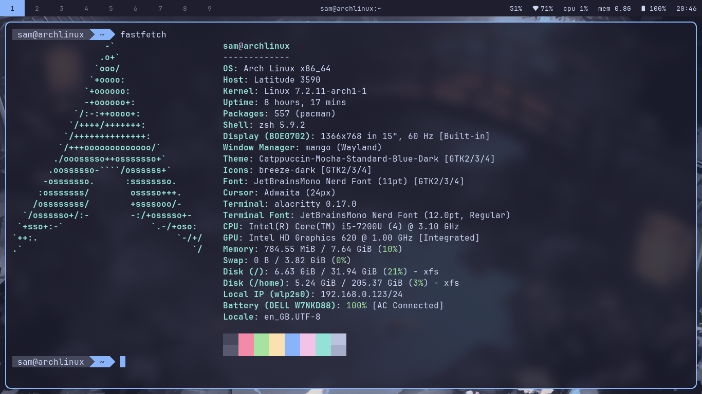
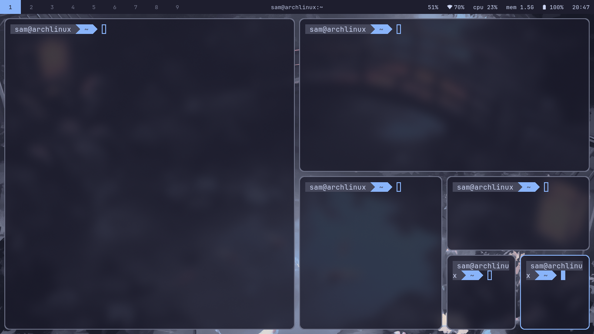
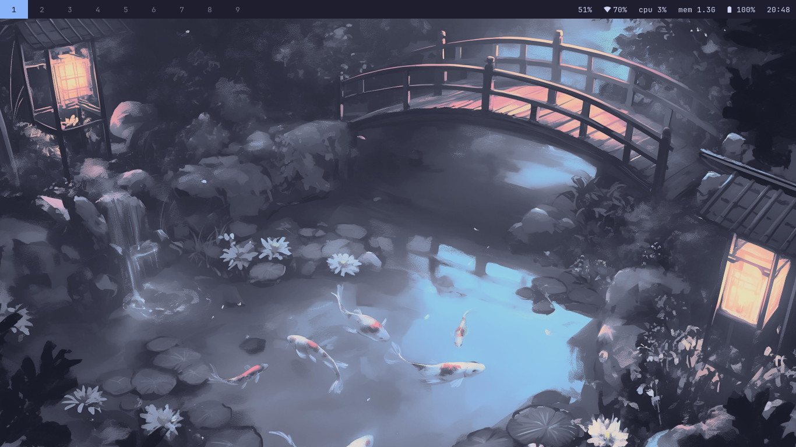

# dotfiles-mangowm

my catppuccin mocha setup for mangowm.

## gallery





im pretty new to ricing so it's not perfect, but it works on my machine. feel free to steal whatever you like.

## what i'm using

- wm: mangowm
- bar: waybar-git
- launcher: rofi
- terminal: alacritty
- notifications: mako
- files: thunar
- font: JetBrainsMono Nerd Font
- gtk theme: [catppuccin mocha](https://www.gnome-look.org/p/1996672)
- wallpaper: [koi.png](https://github.com/orangci/walls-catppuccin-mocha/blob/master/koi.jpg?raw=true)
- screenshot utilities: grim + slurp

gtk stuff is in `gtk-3.0`, `gtk-4.0`, `nwg-look` and `xsettingsd`. there's also an `htop` config and some xfce settings that thunar uses.

## installing

these are just my config folders, so install the programs first. you need the nerd font too or your icons will be empty boxes.

### packages (arch)

```
yay -S mangowm waybar-git rofi alacritty mako thunar grim slurp nwg-look xsettingsd htop ttf-jetbrains-mono-nerd
```

### configs

back up your own stuff first, because this will overwrite it:

```
cp -r ~/.config ~/.config.bak
```

then clone and copy the core folders:

```
git clone https://github.com/goose1414/dotfiles-mangowm
cd dotfiles-mangowm
cp -r waybar rofi alacritty mako mango ~/.config/
```

optional extras (gtk theming, thunar settings, htop):

```
cp -r gtk-3.0 gtk-4.0 nwg-look xsettingsd htop Thunar ~/.config/
cp -r xfce4 ~/.config/
```

restart mangowm and it should work. if something doesn't load, check the paths first (see heads up below).

## heads up

some configs might have paths that only work on my setup. if something doesn't load, check the paths first.

some of the dotfiles were made with help from claude, but from my testing they are stable and pretty
